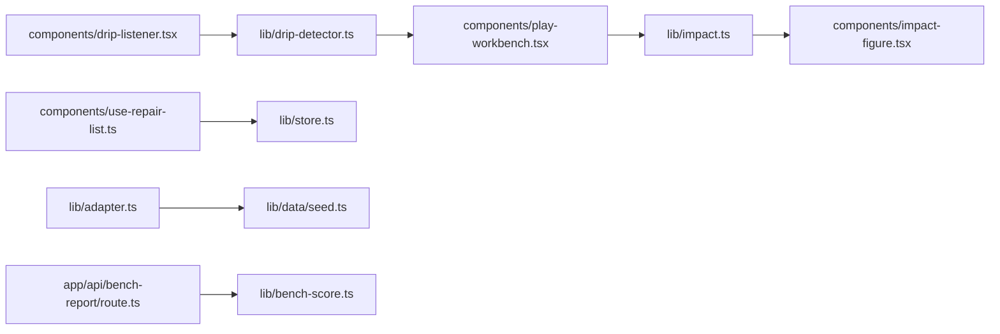

# Guttora

Guttora counts a dripping tap by ear on your phone and tells you how many litres of water, and for a hot tap how many kWh and kg of CO2e, it wastes in a year. A tap that drips once a second loses about 7,900 litres a year at the USGS drop size, and it stays broken because the repair request has no number in it.

> Live demo: https://guttora.vercel.app
>
> Source: https://github.com/mericcintosun/guttora

Start on `/` and scroll the story of one tap (DEMO step 1), then open `/play` and press "Start listening".

## Try it in 60 seconds

1. Open https://guttora.vercel.app on a phone and scroll the five story chapters about tap C-214.
2. Tap "Bench" and press "Start listening", then allow the microphone once.
3. Set the phone next to a dripping tap: the counter ticks on every drop and the litres a year figure and its bar climb together.
4. Press "Add to repair list", then "Copy repair request" to get a ranked ticket with every number in it.

What is real and what is sample data: the drip counter uses this phone's microphone, and the starting repair list is sample data for Ayazağa Student Residence.

## The problem

Dripping taps stay broken for months because a single drop looks like nothing. At the USGS drop size of 0.25 mL, a tap that drips once a second loses about 7,900 litres a year, and a repair request that only says "tap dripping" waits behind everything with a number attached.

## Who it is for

- Students in shared residences and the floor representatives who collect repair requests.
- Tenants who need a number before a landlord will act.
- Residence and campus facilities staff deciding which tap to fix first.

## The solution

Guttora is a single browser tab. No install, no account, no hardware, and the audio never leaves the device.

1. **Drip counter.** The microphone signal is high-passed at 1 kHz and cut into 1024-sample FFT windows. A drop counts when the positive spectral flux clears an adaptive threshold (rolling median times 1.5 plus 4 times the median absolute deviation) and at least 120 ms have passed since the last drop. If the gaps vary by less than 35%, it is a regular drip and the rate is shown; if the drops stop, it says "no regular drip, 0 L".
2. **Spoon calibration.** Hold a 5 mL teaspoon under the tap while the counter runs and press a button when it is full. Spoon volume divided by drops counted is this tap's real drop size. Without a spoon, Guttora uses the USGS assumption of 15,140 drops per gallon.
3. **Impact converter.** Litres a year = drops per minute × 525,600 × mL per drop / 1000. For a hot tap, kWh = litres × 4.186 × temperature rise / 3600 / heater efficiency, and kg CO2e uses a national grid factor (electric) or the natural gas factor (gas boiler).
4. **Repair list.** Every measured tap goes into a list ranked by yearly loss, with a "copy repair request" button that writes a ticket with every number attached.
5. **Recording mode and accuracy bench.** Upload a recording instead of using the microphone. The notes page runs the detector over six synthetic recordings with a known drop count, so anyone can check the logic.

## Expected environmental benefit

A measured tap is a tap that gets fixed sooner. Our sample residence of ten taps (in the app) loses about 64,000 litres a year across its nine open taps, plus the electricity and gas to heat the hot ones. The repair list puts the worst leak first and shows the litres each fixed tap no longer wastes.

## Tech stack

- Next.js 15 (App Router), React 19, TypeScript 5 (strict), Tailwind CSS 4
- GSAP 3 with `@gsap/react` 2 (ScrollTrigger for the home story)
- zod 4 for API input validation
- Web Audio API in the browser: getUserMedia, BiquadFilterNode, ScriptProcessorNode, decodeAudioData
- Our own radix-2 FFT and spectral flux onset detector (`lib/drip-detector.ts`), no ML model
- localStorage for the repair list, Node's built-in test runner for the detector tests, deployed on Vercel



## Limitations

- Echo, extractor fans and running water elsewhere can produce false counts. The regularity check catches most of them, but two taps dripping in the same room look like one noisy source.
- Without the spoon, results rely on the 0.25 mL default, which can be off by a third.
- Hot water energy uses a temperature rise you set and a fixed heater efficiency. Grid factors are approximate national yearly averages.
- Pumping and treating the water also cost energy; we do not count it yet, so our CO2e is an underestimate.
- All audio used for testing is synthetic or recorded by us. Field counts from our own taps go here as we record them.

## Quickstart

Node 22.6 or newer.

```bash
npm install
npm run dev
npm test
npm run proof
```

Open http://localhost:3000. The microphone needs HTTPS or localhost, so on a phone use the deployed URL. No secrets are needed (see `.env.example`).

## Addresses

| Name | Address |
| --- | --- |
| Live | https://guttora.vercel.app |

## Prize track

Guttora enters one track, the main placement prize, which needs no sponsor API and no API key.

| Bounty | Prize | Slots | Required tech | Code file | DEMO step |
| --- | --- | --- | --- | --- | --- |
| Green Shift Grand Prize | $ 125 in cash | 1 | none | `components/impact-figure.tsx`, `lib/impact.ts` | 3 |

Judging criterion, quoted: "Environmental Impact: How clearly the project reduces waste, emissions, resource use, or environmental harm."

## Demo reset

1. Run `npm run demo:reset`. It rewrites the seed snapshot and prints the seed version and the reset URL.
2. Open `/play?reset=1` on the demo phone. The repair list goes back to the 10 sample taps at Ayazağa Student Residence.

## Detector proof

The tables below are written by `npm run proof`, not by hand. The bench clips are synthetic: `lib/synth.ts` builds each one with a known number of drops, and the same detector the phone uses counts them. They test the logic, not a real bathroom.

### Synthetic bench, counted by the detector

<!-- PROOF:BEGIN detector-bench -->
The six clips below are synthetic: generated by `lib/synth.ts` with a known drop count, not recorded at a real tap. A clip passes when the count is within 1 drop of the truth and the verdict is right.

| Clip | Conditions | True drops | Counted | Verdict | ms |
| --- | --- | ---: | ---: | --- | ---: |
| Quiet bathroom | 52 drops a minute, light hiss | 26 | 26 | pass, regular drip | 286 |
| Slow basin | 12 drops a minute, light hiss | 6 | 6 | pass, regular drip | 268 |
| Fast shower | 110 drops a minute | 54 | 54 | pass, regular drip | 266 |
| Extractor fan on | 60 drops a minute under a 100 Hz hum | 30 | 30 | pass, regular drip | 326 |
| Someone talking | 45 drops a minute under a voice | 22 | 22 | pass, regular drip | 373 |
| Tap closed | fan and voice, no drops | 0 | 0 | pass, no regular drip | 435 |

6 of 6 synthetic clips passed, with a total error of 0 drops across 138 true drops, measured on Node v22.23.3 on 2026-11-25.
<!-- PROOF:END detector-bench -->

### Unit tests (`tests/detector.test.ts`)

<!-- PROOF:BEGIN unit-tests -->
9 passed, 0 failed. `npm test` ran `tests/detector.test.ts` on Node v22.23.3 on 2026-11-25.
<!-- PROOF:END unit-tests -->

## What we would build next

- Move capture to an AudioWorklet and test on more phones, including older iPhones.
- Record twenty real taps, hand-count them, and publish the table here.
- A shared repair list per residence so a whole block sees the same ranking.

## AI use

The hackathon pages we read state no AI policy. We used AI coding assistants for scaffolding and code. The detector design, product decisions and final review are ours. The product itself runs no AI model.

## License

MIT (see LICENSE).

Open source used: Next.js, React, TypeScript, Tailwind CSS, GSAP and `@gsap/react`, zod, class-variance-authority, clsx, tailwind-merge and Radix Slot. Constants and data sources: USGS (drop size), UK DESNZ (natural gas factor) and Ember (grid carbon intensity), cited on the notes page.
